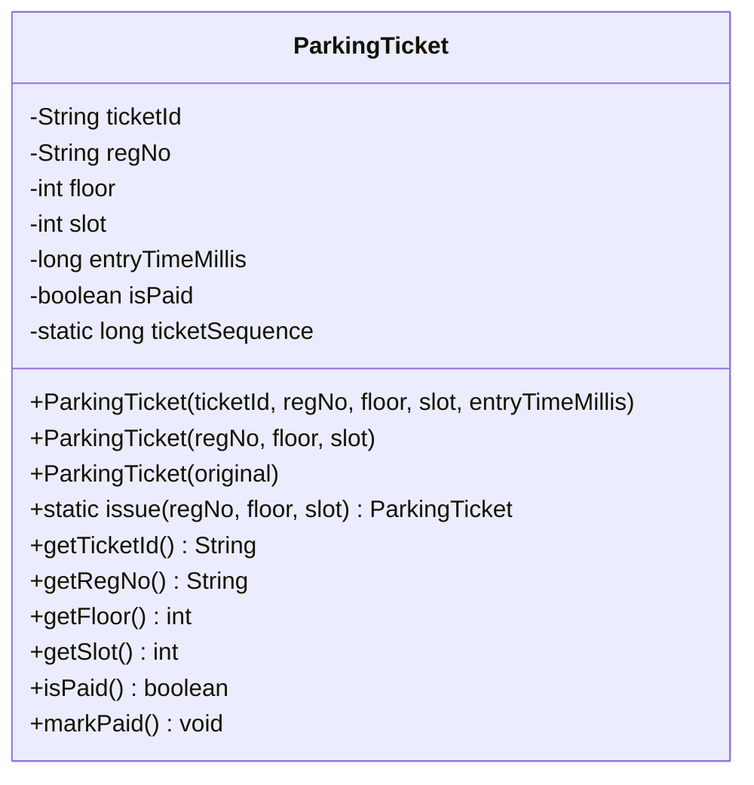

# TASK 4: Design Classes, Objects and Constructors
**Bloom’s Level:** K4 – Analyse  
**Marks:** 4  
**Course Outcome:** CO1 — Object-Oriented Design, Constructor Mechanics, Memory Layout (Stack vs Heap)  

---

## 1. Class Design & State Modeling

The core domain classes embody Single Responsibility and encapsulation:

### 1.1 Field and Method Specifications


- **`ticketId` (`final String`):** Uniquely identifies ticket transaction; immutable.
- **`regNo` (`final String`):** Vehicle registration plate number; immutable.
- **`floor`, `slot` (`final int`):** Physical location assigned at gate; immutable.
- **`entryTimeMillis` (`final long`):** Precise hardware epoch milliseconds; immutable.
- **`isPaid` (`boolean`):** Mutable flag tracking payment lifecycle.

---

## 2. Constructor Design Patterns & Mechanics

### 2.1 Canonical Parameterized Constructor
The canonical constructor accepts all mandatory properties and validates invariants fail-fast:
```java
public ParkingTicket(String ticketId, String regNo, int floor, int slot, long entryTimeMillis) {
    if (ticketId == null || ticketId.isBlank()) throw new IllegalArgumentException("Invalid Ticket ID");
    if (regNo == null || regNo.isBlank()) throw new IllegalArgumentException("Invalid Registration Number");
    if (floor < 0 || slot < 0) throw new IllegalArgumentException("Invalid coordinates");
    this.ticketId = ticketId;
    this.regNo = regNo.toUpperCase().trim();
    this.floor = floor;
    this.slot = slot;
    this.entryTimeMillis = entryTimeMillis;
    this.isPaid = false;
}
```

### 2.2 Overloaded Constructors & Chaining with `this(...)`
Constructor overloading provides convenience for client code while delegating to the canonical constructor using `this(...)`:
```java
public ParkingTicket(String regNo, int floor, int slot) {
    this("TKT-" + (++ticketSequence), regNo, floor, slot, System.currentTimeMillis());
}
```
- **Architectural Value:** Prevents duplication of invariant validation code (DRY Principle). If validation rules change, only the canonical constructor requires modification.
- **Rule of Java:** `this(...)` must always be the very first statement in a constructor.

### 2.3 The Copy Constructor (Defensive Cloning for Duplicate Slips)
- **Problem:** If a campus commuter misplaces their paper ticket or requests a secondary receipt slip, passing around the original `ParkingTicket` object reference introduces **aliasing bugs** (two callers holding a pointer to the same heap object; mutating one mutates the other).
- **Solution:** A copy constructor creates a completely independent clone on the heap with duplicate tracking metadata:
```java
public ParkingTicket(ParkingTicket original) {
    if (original == null) throw new IllegalArgumentException("Source ticket cannot be null");
    this.ticketId = original.ticketId + "-DUP";
    this.regNo = original.regNo;
    this.floor = original.floor;
    this.slot = original.slot;
    this.entryTimeMillis = original.entryTimeMillis;
    this.isPaid = original.isPaid;
}
```

---

## 3. JVM Memory Allocation Model: Stack vs. Heap

When the statement `ParkingTicket t1 = new ParkingTicket("TN01AA1111", 1, 5);` executes:

1. **JVM Thread Stack:**
   - A local variable reference `t1` (size: 4 bytes with Compressed OOPs, or 8 bytes) is allocated on the executing thread's stack frame.
   - It contains the 64-bit memory address pointing to the heap object.
2. **JVM Heap (Eden Space):**
   - The `new` keyword allocates a contiguous block of heap memory:
     - **Mark Word (8 bytes):** Stores hash code, biased locking flags, GC age bits.
     - **Klass Word (4 bytes):** Pointer to `ParkingTicket.class` metadata in Metaspace.
     - **Instance Fields:**
       - `ticketId` (4 bytes reference) $\to$ points to String object in Heap/String Pool.
       - `regNo` (4 bytes reference) $\to$ points to String object in Heap/String Pool.
       - `floor` (4 bytes primitive `int`).
       - `slot` (4 bytes primitive `int`).
       - `entryTimeMillis` (8 bytes primitive `long`).
       - `isPaid` (1 byte primitive `boolean`).
       - **Padding (7 bytes):** JVM 8-byte boundary alignment.
     - **Total Instance Size:** $8 + 4 + 4 + 4 + 4 + 4 + 8 + 1 + 7 = 44\text{ bytes} \to 48\text{ bytes}$ aligned.

---

## 4. Alternative Concept and Complexity Analysis

### 4.1 Comparing Construction Paradigms

| Feature | Parameterized Constructor + Chaining | JavaBeans Pattern (Default + Setters) | Static Factory Methods |
| :--- | :--- | :--- | :--- |
| **Object Invariant Guarantee** | **Guaranteed.** Object is never exposed in a half-initialized state. | **Fails.** Object is constructed empty (`new JavaBean()`); invalid until last setter finishes. | **Guaranteed.** Validates before calling private constructor. |
| **Immutability Support** | **Full.** Allows fields to be declared `final`. | **Fails.** Fields cannot be `final` because setters must mutate them. | **Full.** Fields can be declared `final`. |
| **Thread Safety** | **Thread-safe.** Immutability ensures safe publication across threads. | **Not thread-safe.** Risk of race condition during setter invocations. | **Thread-safe.** |
| **Readability & Intent** | Good for few parameters. | Verbose; requires multiple lines per object. | High semantic clarity (`ParkingTicket.issue(...)`). |

### 4.2 Time and Space Complexity for Creating $N$ Objects
- **Time Complexity:** $\mathcal{O}(1)$ time per object across all three methods. However, the JavaBeans pattern requires 5 distinct method invocations (`setTicketId`, `setRegNo`, `setFloor`, `setSlot`, `setEntryTimeMillis`), incurring higher bytecode execution overhead compared to inlined constructor initialization.
- **Space Complexity:** All three methods produce an object occupying the identical $\approx 48\text{ bytes}$ on the JVM heap. However, the JavaBeans pattern creates mutable reference structures that complicate escape analysis and prohibit JVM register scalar replacement.
