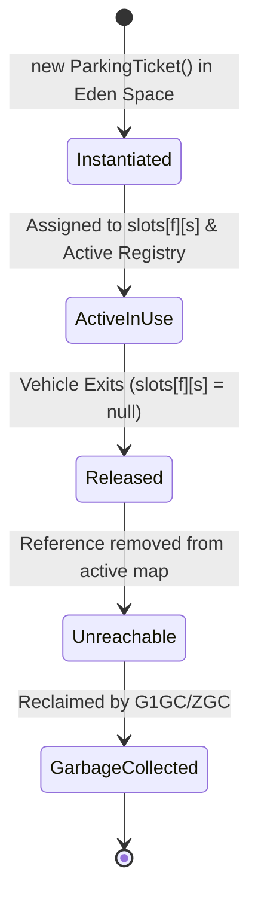

# TASK 5: Apply static Members and the Object Life Cycle
**Bloom’s Level:** K4 – Analyse  
**Marks:** 3  
**Course Outcome:** CO1 — Static Context, Class-Level State, JVM Garbage Collection, and Parameter Passing  

---

## 1. Class-Level State vs. Instance-Level State

### 1.1 Where `static` Variables are Mandatory
A `static` variable belongs to the class itself rather than any individual object instance:
- **Global Sequential Ticket Counter:** If the ticket serial counter were an instance variable of `ParkingTicket`, every new ticket would initialize its own counter to zero or one upon construction. An instance variable cannot maintain a monotonic sequence across independent object instantiations.
- **Facility Configuration Constants:** `public static final double BASE_CAR_RATE = 30.0;` avoids duplicating immutable configuration values inside hundreds of vehicle objects on the heap.
- **Total Campus Active Occupancy:** Tracks concurrent vehicles across the university without iterating through all floor arrays.

### 1.2 Appropriate Usage of Static Methods and Static Blocks
- **Static Blocks (`static { ... }`):** Execute once when the JVM ClassLoader loads the bytecode into Metaspace. Used to load configuration properties, establish database connections, or warm up cache tables.
- **Static Methods:** Pure mathematical or utility functions that operate exclusively on passed parameters without depending on instance state (`this`). Example: `ParkingUtils.roundUpToCeilHours(int minutes)`.
- **Static Factory Methods:** Factory constructors that provide domain-expressive naming (`ParkingTicket.issue(...)`).

---

## 2. Object Life Cycle and Garbage Collection Eligibility



### Detailed Life Cycle Phases:
1. **Creation & Allocation:** Calling `new ParkingTicket(...)` allocates object memory in the Eden space of the Young Generation on the JVM Heap.
2. **Active State:** The object is referenced by active GC Roots:
   - Reference in the `slots[floor][slot]` array.
   - Reference in the active transactions registry map.
   - Stack frame references in the gate handler thread.
   During this phase, the object is **reachable** and cannot be collected.
3. **Dereferencing on Departure:** When the vehicle departs and settles payment:
   - `slots[floor][slot] = null;`
   - `activeTicketsMap.remove(regNo);`
4. **Garbage Collection Eligibility:**
   - Once all stack variables go out of scope and all data structure pointers are cleared, the object has **zero incoming reference edges** from any GC Root.
   - The object becomes eligible for garbage collection.
   - During the next Young Generation GC cycle (G1GC / ZGC), the garbage collector identifies the unreferenced object and sweeps its memory back into the available allocation buffer.

---

## 3. Java Parameter Passing: Pass-by-Value Semantics

A foundational concept in Java: **Java is strictly pass-by-value, always.**

1. **Primitive Types:** The method receives an independent bitwise copy of the primitive value. Modifying the parameter inside the method has zero effect on the caller's variable.
2. **Object Reference Types:** The method receives a bitwise copy of the **reference pointer** (memory address on the heap).
   - **Mutating Object State:** Calling `ticket.markSettled()` dereferences the copied pointer and mutates the single shared object on the heap. Both caller and callee observe this change.
   - **Reassigning the Reference:** Executing `ticket = new Ticket(...)` merely overwrites the local parameter pointer on the callee's stack frame. The caller's reference variable continues pointing to the original heap object undisturbed.

---

## 4. Alternative Concept and Complexity Analysis

### 4.1 Multi-Facility Ticket Counter Problem (North Gate vs. South Gate)

Suppose the university operates two distinct facilities: **North Gate Facility** and **South Gate Facility**.

#### Approach 1: JVM-wide `static` Counter
```java
public class ParkingTicket {
    private static long globalCounter = 1000;
}
```
- **Behavior:** Both North Gate and South Gate draw from the same sequence:
  - North Gate: `TKT-1001`
  - South Gate: `TKT-1002`
  - North Gate: `TKT-1003`
- **Drawbacks:**
  - Couplings independent physical gates.
  - If North Gate crashes or is disconnected, South Gate ticket audits exhibit "missing gaps" in serial sequences.
  - In a multi-threaded system, requires heavy synchronized locking or atomic CAS operations (`AtomicLong`) across all gates.

#### Approach 2: Facility `instance` Counter (Recommended Architecture)
```java
public class ParkingFacility {
    private final String facilityPrefix; // "NG" or "SG"
    private long facilityTicketSeq = 1000;

    public String nextTicketId() {
        return facilityPrefix + "-" + (++facilityTicketSeq);
    }
}
```
- **Behavior:** Each facility owns its own monotonically increasing sequence:
  - North Gate: `NG-1001`, `NG-1002`, `NG-1003`
  - South Gate: `SG-1001`, `SG-1002`, `SG-1003`
- **Benefits:**
  - Completely decoupled auditing and reporting per physical building.
  - No cross-facility lock contention.

### 4.2 Space Complexity Analysis
For $k$ parking facilities issuing a total of $n$ tickets:
- **Global Static Counter:** Consumes exactly $8\text{ bytes}$ (one `long` in Metaspace / class mirror). Space: $\mathcal{O}(1)$.
- **Instance Counter per Facility:** Consumes $8\text{ bytes}$ per `ParkingFacility` object. For $k$ facilities, total space is $8k\text{ bytes}$. Space: $\mathcal{O}(k)$.
- **Conclusion:** Since the number of facilities $k$ is tiny ($k \ll 100$), the negligible $\mathcal{O}(k)$ memory cost of instance counters delivers massive architectural gains in modularity, auditability, and zero contention.
