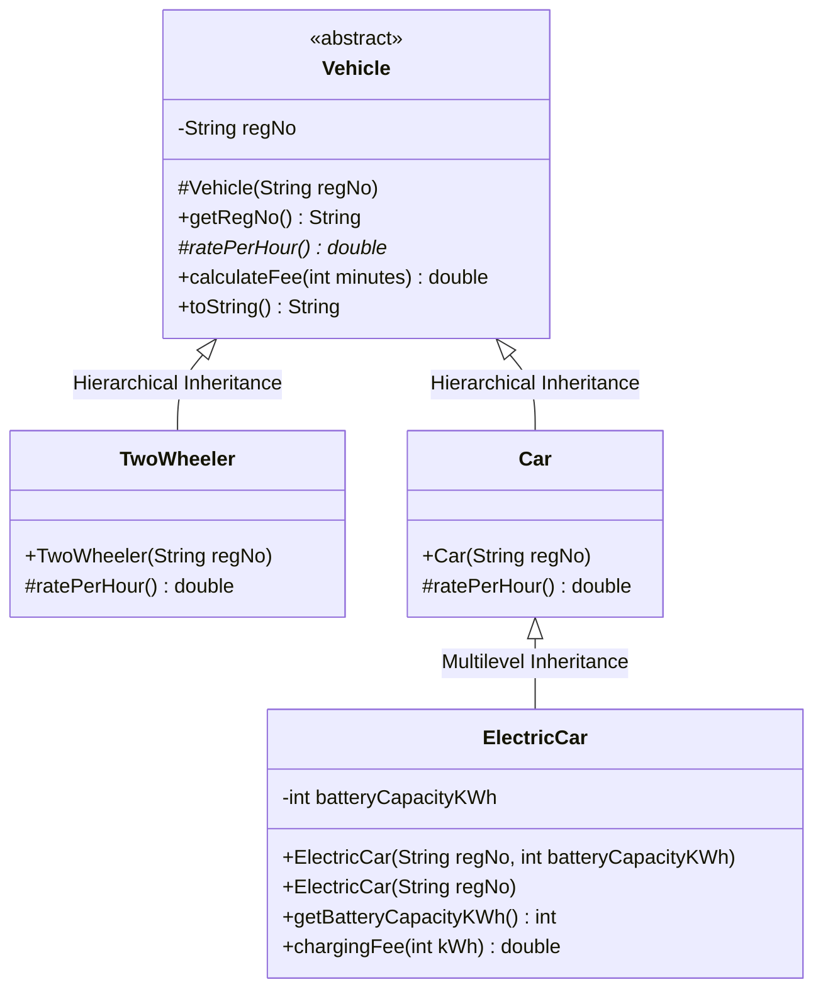
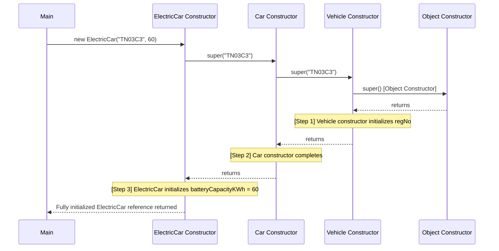

# TASK 6: Design the Inheritance Hierarchy
**Bloom’s Level:** K4 – Analyse  
**Marks:** 4  
**Course Outcome:** CO1 — Inheritance Mechanisms, Constructor Chaining (`super`), UML Modeling  

---

## 1. Inheritance Hierarchy Design



### 1.1 Types of Inheritance Employed
1. **Hierarchical Inheritance:**
   - Both `TwoWheeler` and `Car` directly extend the abstract superclass `Vehicle`.
   - Inherit `regNo`, constructor validation, and base `calculateFee(minutes)` template logic.
2. **Multilevel Inheritance:**
   - `Vehicle` $\to$ `Car` $\to$ `ElectricCar`.
   - `ElectricCar` is a specialized `Car` that inherits the 4-wheel car tariff (`Rs. 30/hr`) while augmenting it with electric charging behavior (`chargingFee()`).

### 1.2 State and Behavior Inheritance Breakdown
| Class | Inherited from Superclass | Added / Specialized in Subclass |
| :--- | :--- | :--- |
| **`Vehicle`** | Root `Object` class methods (`equals`, `hashCode`, `toString`) | `regNo`, `calculateFee(minutes)`, abstract `ratePerHour()`. |
| **`TwoWheeler`** | `regNo`, `calculateFee(minutes)` | Specializes `ratePerHour()` to return `10.0`. |
| **`Car`** | `regNo`, `calculateFee(minutes)` | Specializes `ratePerHour()` to return `30.0`. |
| **`ElectricCar`** | `regNo`, `ratePerHour() = 30.0`, `calculateFee()` from `Car` | Adds `batteryCapacityKWh`, adds `chargingFee(int kWh)`. |

---

## 2. The `super` Keyword Mechanics

1. **`super(...)` for Constructor Delegation:**
   - Subclass constructors do not inherit superclass constructors.
   - The first line of a subclass constructor must invoke `super(...)`.
   - Example: `TwoWheeler` calls `super(regNo)` to pass the registration plate string to `Vehicle` for validation and private field assignment.
2. **`super` for Method Invocation:**
   - In `ElectricCar.toString()`, calling `super.toString()` reuses the string representation of `Car` while appending `(EV 40kWh)`.

---

## 3. Constructor Execution Order Trace: Creating `ElectricCar`

When executing `Vehicle ev = new ElectricCar("TN03C3", 60);`:



### Empirical Trace Output:
```text
[Constructor Step 1] Vehicle(String regNo) invoked for: TN03C3
[Constructor Step 2] Car(String regNo) completed.
[Constructor Step 3] ElectricCar(String regNo, int batteryCapacityKWh) completed with capacity: 60 kWh
```

---

## 4. Alternative Concept and Complexity Analysis

### 4.1 Inheritance (`Car is-a Vehicle`) vs Composition (`Vehicle has-a VehicleType`)

#### Composition Design:
```java
public class ComposedVehicle {
    private final String regNo;
    private final VehicleType type; // HAS-A relationship
    private final boolean isElectric;
    // Methods delegate to type.getRate()
}
```

#### Comparison Matrix:

| Evaluation Aspect | Inheritance (`is-a`) | Composition (`has-a`) |
| :--- | :--- | :--- |
| **Adding New Vehicle Type** | **Zero modifications to existing code.** Create a new subclass `class DeliveryVan extends Vehicle`. Strictly adheres to Open-Closed Principle (OCP). | **Modifies existing code.** Must edit the `VehicleType` enum, add switch/if branches in `ComposedVehicle`. Violates OCP. |
| **Time to Compute Fee** | $\mathcal{O}(1)$ direct virtual method table (vtable) dispatch. | $\mathcal{O}(1)$ method call + 1 pointer dereference to delegate object (`type.getRate()`). Minor extra indirection. |
| **Memory Footprint per Object** | Minimal: Object header ($12\text{ bytes}$) + fields. No auxiliary pointer overhead. | Additional pointer reference for the `type` field ($4\text{ bytes}$ with Compressed OOPs) + enum object reference. |
| **Specialized Subclass State** | Clean. `ElectricCar` holds `batteryCapacityKWh`; `Car` does not waste memory storing battery fields. | Clumsy. If modeled via single class, `ComposedVehicle` must hold nullable fields (`batteryCapacity`, `trailerLength`) that remain unused for ordinary cars. |
